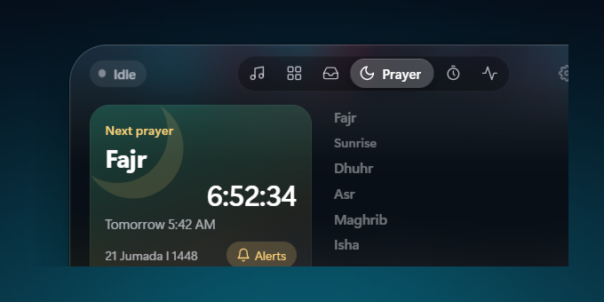
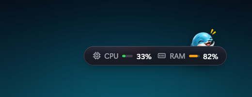
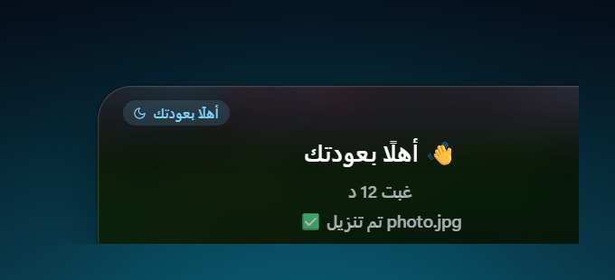

<div align="center">

# Soqo Island · سوكو آيلاند

**A Living Island for Windows.**

Your music, downloads, apps, files and alerts in one glass capsule at the top of your screen,
with **Soqi the Dolphin** for company.

Free and open source (GPL-3.0) · Windows 10/11 (64-bit) · English · العربية


</div>

> **Status: public beta in preparation.** The rebuild lives on the `rebuild/soqo-island`
> branch; no release has been published yet. See [CHANGELOG.md](CHANGELOG.md) and
> [`docs/MIGRATION_STATUS.md`](docs/MIGRATION_STATUS.md).

## What it does

- **Music** — whatever Windows is playing (Spotify, YouTube, any player): artwork, title,
  waveform, transport, system volume and brightness, and a floating mini player for YouTube.
- **Soqi** — an original dolphin companion with ten moods who peeks at the cursor, dances to
  your music, cheers finished downloads, warns when the internet drops and dozes off when you
  step away. Switchable off; respects Windows' reduced-motion setting.
- **Downloads** — browser downloads at a glance (progress, speed, done) and live control of
  the IDM download manager when it is installed.
- **Apps & Shelf** — a pinned launcher and a shelf for files you are working with.
- **Smart clipboard** — copy a link, a sum or a colour and get the one useful action.
  History stays in memory only.
- **Privacy dots** — see which app is using your microphone or camera.
- **Meetings** — upcoming events from a private iCal link with one-click Join.
- **Timer & focus sessions**, weather, CPU/RAM, battery, keyboard-language and Caps Lock
  toasts, network status, screenshots straight to the shelf.
- **Optional Islamic features** — prayer times calculated on your PC with the method of
  your choice, notifications, dhikr, du'a and Qur'an verses in the KFGQPC Hafs script.
  **Off by default for new installations**; turn them on under Settings › Features.
- **Your island, your way** — horizontal or vertical, docked or floating, hides in full
  screen, sits inside the browser's address bar, launches at Windows startup if you want.

<div align="center">

| English | Arabic |
|---|---|
|  |  |
|  |  |


</div>

## Install

1. Download `Soqo-Island-Setup-<version>.exe` from the [Releases page](../../releases)
   (once published).
2. Run it. The build is not code-signed yet, so Windows SmartScreen may show "Windows
   protected your PC": choose **More info → Run anyway**. The installer offers English and
   Arabic.
3. The island appears at the top of your screen. Press **Ctrl + Alt + I** to open it,
   right-click it or the tray icon for the menu, and visit **Settings** to personalise it.

Requires Windows 10 or 11, 64-bit.

## Privacy and security, in short

Soqo Island has no account, no analytics and no telemetry. It reads the clipboard only for
the features you keep on (memory only), captures the screen area under the island only for
the live glass effect (switchable off), and talks to the network only for weather, your own
calendar link, update checks and the YouTube embed. All windows are sandboxed with strict
content-security policies and Electron fuses. Details: [`docs/PRIVACY.md`](docs/PRIVACY.md),
[`docs/SECURITY_AUDIT.md`](docs/SECURITY_AUDIT.md), [`SECURITY.md`](SECURITY.md).

## Build from source

```bash
npm install
npm start          # run it
npm run verify     # syntax check, lint, types, i18n parity, tests
npm run dist       # build the installer into dist/
```

The native helper (`helper/soqo-helper.exe`) is built from `helper/*.cs` with the C# compiler
that ships with Windows: `npm run helper:build`. Development data can be isolated with
`SOQO_USER_DATA=<folder>`.

## Documentation

- [`docs/ARCHITECTURE.md`](docs/ARCHITECTURE.md) — processes, modules, trust boundaries
- [`docs/LOCALIZATION.md`](docs/LOCALIZATION.md) — English / Arabic, RTL, adding a language
- [`docs/TRANSLATION_REVIEW.md`](docs/TRANSLATION_REVIEW.md) — Arabic strings awaiting review
- [`docs/PRIVACY.md`](docs/PRIVACY.md) — what is read, stored and sent
- [`docs/RELEASING.md`](docs/RELEASING.md) — build, sign, publish (owner-approved only)
- [`docs/MIGRATION_PLAN.md`](docs/MIGRATION_PLAN.md), [`docs/MIGRATION_STATUS.md`](docs/MIGRATION_STATUS.md),
  [`docs/REGRESSION_CHECKLIST.md`](docs/REGRESSION_CHECKLIST.md) — the rebuild, stage by stage
- [`docs/ART_ASSET_REQUESTS.md`](docs/ART_ASSET_REQUESTS.md) — artwork pipeline and requests
- [`CONTRIBUTING.md`](CONTRIBUTING.md) · [`CHANGELOG.md`](CHANGELOG.md) · [`NOTICE.md`](NOTICE.md)

## Coming from Nova Island

Soqo Island keeps its data in `%APPDATA%\soqo-island`. On first start it copies the settings
of a Nova Island installation (`%APPDATA%\dynamic-nova`) and leaves that folder untouched.
If your prayer features were at their defaults, it asks once whether to keep them.

## Known limitations

- Unsigned build (SmartScreen warning on first run).
- Arabic text written during the rebuild and awaiting native-speaker review.
- The "adhan sound" is a soft chime, not a recorded adhan.
- Tested on one Windows 11 machine so far; multi-monitor and high-DPI feedback is welcome.

## Developer and license

Developed by **Rami Al-Hakimi** — [github.com/rami-hakimi](https://github.com/rami-hakimi) —
Netherlands.

Soqo Island is free software under the [GNU General Public License v3.0](LICENSE).
Copyright © 2026 Rami Al-Hakimi and Soqo Island contributors. Based on **Nova Island**,
Copyright © 2026 Nova Island by AmerTech, GPL-3.0; the name "Nova Island", the Nova character
and the Nova logo belong to the upstream project and are not used here. Third-party notices:
[`NOTICE.md`](NOTICE.md).

The Qur'an font in `assets/fonts/` (KFGQPC HAFS Uthmanic Script by the King Fahd Glorious
Quran Printing Complex) is included unmodified under its own licence, see
[assets/fonts/KFGQPC-LICENSE.txt](assets/fonts/KFGQPC-LICENSE.txt). It is not covered by the GPL.

The name "Soqo Island" and the Soqi character are the marks of this project; please use a
different name and mascot for modified versions.

---

<div dir="rtl" align="right">

## سوكو آيلاند

جزيرة حيّة على سطح مكتب ويندوز: الموسيقى والتنزيلات والتطبيقات والملفات والتنبيهات في كبسولة
زجاجية واحدة أعلى الشاشة، ومعك **سوقي الدلفين**. الواجهة بالعربية والإنجليزية مع دعم كامل
للكتابة من اليمين إلى اليسار، بلا حسابات ولا تتبّع.

الميزات الإسلامية (مواقيت الصلاة، التنبيهات، الأذكار والأدعية وآيات القرآن بخط مجمع الملك فهد)
اختيارية ومعطّلة في التثبيت الجديد؛ تُفعَّل من الإعدادات ← الميزات.

البرنامج مجاني ومفتوح المصدر برخصة GPL-3.0، ويعمل على ويندوز 10 و11 (64 بت).
تطوير رامي الحكيمي — هولندا.

</div>
