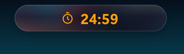
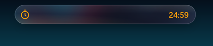
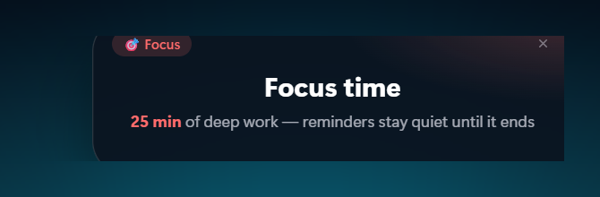
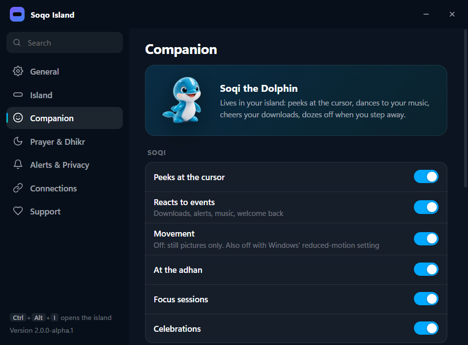
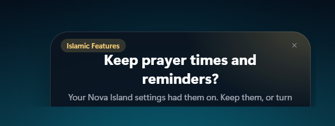
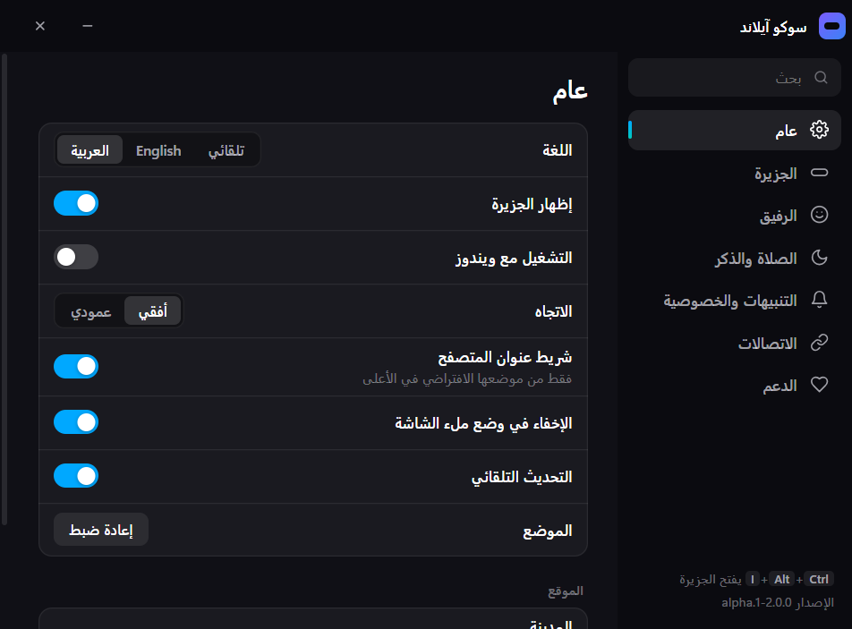

<div align="center">

# Soqo Island · سوكو آيلاند

**A Living Island for Windows.**

A customizable floating desktop companion for Windows 10 and 11, inspired by Dynamic
Island-style interfaces: your music, downloads, apps, files and alerts in one glass capsule at
the top of the screen, with **Soqi the Dolphin** for company.

Free and open source (GPL-3.0) · Windows 10/11 (64-bit) · English · العربية


<sub>Promotional concept illustration, not a screenshot.</sub>

</div>

> **Status: first public beta in preparation.** The code lives on the `rebuild/soqo-island`
> branch and no installer has been published yet. Progress: [`CHANGELOG.md`](CHANGELOG.md),
> [`docs/MIGRATION_STATUS.md`](docs/MIGRATION_STATUS.md).

> **About the pictures.** The five large illustrations on this page are **promotional concept
> art** made to convey the look and the ideas of Soqo Island. They are not screenshots, and
> some details differ from the shipped application (for example a Dutch language option or
> click-to-react gestures for Soqi, neither of which exists yet). Everything labelled
> *screenshot* is a genuine capture of the running application; more are under
> [`assets/screenshots/app/`](assets/screenshots/app/).

## Contents

- [What Soqo Island is](#what-soqo-island-is)
- [Key features](#key-features)
- [Installation](#installation)
- [How to use Soqo Island](#how-to-use-soqo-island)
- [Gallery](#gallery)
- [Privacy and security](#privacy-and-security)
- [For developers](#for-developers)
- [Contributing](#contributing)
- [Known limitations](#known-limitations)
- [Credits and licensing](#credits-and-licensing)
- [بالعربية](#سوكو-آيلاند)

## What Soqo Island is

Soqo Island is a small, always-available capsule that floats over your desktop. Most of the
time it is a slim pill at the top of the screen showing what matters right now: the song that
is playing, a running timer, a download that just finished, the next meeting. Rest the pointer
on it and it opens into a glass panel with tabs for music, apps, files, system information and
more. Move away and it folds back. It never steals focus from the window you are working in.

**Soqi the Dolphin** lives in and around the island. Soqi is an original character with ten
moods driven by real events on your PC: curious when you type in the app search, dancing when
music plays, cheering a finished download, worried when the internet drops, dozing when you
step away. Soqi can be switched off, and all movement respects Windows' reduced-motion
setting.

Soqo Island is a rebuild of the open-source Nova Island project (GPL-3.0). It keeps every
feature of the original, adds Arabic, the companion, a privacy layer and a new look, and makes
the religious features optional. Details in [Credits and licensing](#credits-and-licensing).

## Key features

Everything below is implemented and was exercised on Windows 11 during the rebuild
(see [`docs/REGRESSION_CHECKLIST.md`](docs/REGRESSION_CHECKLIST.md) for what was verified by
automation, what by hand, and what is still pending).

| Area | What you get |
|---|---|
| **Floating island** | Click-through glass capsule that opens on hover, horizontal or vertical, docked at the top or placed anywhere, hides in full screen, can sit inside the browser's address bar, `Ctrl + Alt + I` to pin open |
| **Music and media** | Whatever Windows is playing (Spotify, YouTube, any player): artwork, title, waveform, play/pause/skip, system volume and brightness, a floating YouTube mini player |
| **Focus timer** | Preset timers and Pomodoro-style focus/break sessions; a running-timer pill in three sizes that stays visible while you work, optionally even over full-screen apps |
| **Notifications** | Toasts for finished downloads, screenshots, battery, keyboard language and Caps Lock, network changes, upcoming meetings; optional water, break and welcome-back cards |
| **Download monitoring** | Browser downloads at a glance (progress, speed, done) and live control of the IDM download manager when it is installed |
| **Clipboard tools** | Smart clipboard: copy a link, a sum or a colour and get the one useful action; history kept in memory only, copies from password managers skipped |
| **System utilities and shortcuts** | Pinned app launcher with Start-menu search, a shelf for files you are working with, CPU/RAM, weather, screenshots straight to the shelf |
| **Soqi companion** | Ten moods, peeks at the pointer, reacts to downloads, music, network and your return; switches for showing Soqi, peeks, reactions and movement |
| **Privacy controls** | Microphone/camera indicator dots, a switch that turns the live glass backdrop (screen capture under the island) off entirely, clipboard history in memory only, no accounts and no telemetry |
| **Appearance** | Ocean glass theme, Small/Medium/Large timer pill, orientation and docking, live or static glass |
| **Automatic startup** | *Launch at Windows startup* starts the island quietly at sign-in; off again from Settings or Windows Settings › Apps › Startup; removed by the uninstaller |
| **Languages** | English and Arabic with complete right-to-left layouts, switchable live without a restart (Dutch is not available yet) |
| **Optional Islamic Features** | Prayer times calculated on your PC, notifications and chime, dhikr, du'a and Qur'an verses; **off by default** for new installations, one master switch under Settings › Features |
| **Meetings** | Upcoming events from a private iCal link with a one-click Join button |

## Installation

Soqo Island is a normal Windows desktop application: install it once, and it starts with
Windows if you want it to. No account is needed.

1. **Open the repository** at <https://github.com/rami-hakimi/soqo-island->.
2. **Go to Releases** (right-hand column, or `/releases`). The first public beta will appear
   there; until then there is nothing to download yet.
3. **Download the Windows installer**, `Soqo-Island-Setup-<version>.exe` (about 110 MB).
4. **Run the installer.** The beta is not code-signed, so Microsoft SmartScreen may show
   *"Windows protected your PC"*. Only continue if you downloaded the file from this
   repository's Releases page: click **More info**, check that the app name reads *Soqo
   Island*, then **Run anyway**. Do not do this for files from any other source.
5. **Follow the installer.** It offers English and Arabic, installs for the current user only
   (no administrator rights), lets you choose the folder, and creates a Start-menu and a
   desktop shortcut.
6. **Open Soqo Island.** The installer starts it when it finishes; later, use the Start menu.
   The island appears as a pill at the top centre of your main screen, and a dolphin icon
   appears in the notification area.
7. **Configure it.** Right-click the island or the tray icon and choose **Settings…** to pick
   the language (Automatic, English or Arabic), the orientation and docking, Soqi, the timer
   size and the feature switches.
8. **Enable *Launch at Windows startup*** under Settings › General if you want the island to
   be there every time you sign in. It starts quietly, without a console window.
9. **Start using the island**: rest the pointer on the pill to open it, play some music, drop
   a file on the shelf, start a timer.

**Compatibility.** Windows 10 and Windows 11, 64-bit. The beta has been tested on one Windows
11 24H2 machine at 125 % display scaling, with one monitor, in English and Arabic. Reports
from other setups (multiple monitors, other scaling factors, Windows 10) are very welcome.

**Updating.** Installing a newer setup file over an existing installation keeps your settings,
your feature choices and the startup registration. The app also checks this repository's
Releases for updates when *Auto-update* is on.

**Uninstalling.** Windows Settings › Apps › Installed apps › Soqo Island › Uninstall. This
removes the program, its shortcuts and the startup registration. Your settings folder
(`%APPDATA%\soqo-island`) is kept so a reinstall finds your preferences; delete it by hand if
you want a clean slate.

## How to use Soqo Island

**Open and close the island.** Rest the pointer on the pill for a moment and it expands; move
the pointer away and it collapses. A quick sweep across the pill on the way to a browser tab
does not open it. `Ctrl + Alt + I` pins the island open and unpins it again. Drag the pill to
move the island; drop it near the top edge to dock it, or anywhere else to leave it floating.

**Use the timer.** Open the island and choose the **Timer** tab. Pick a preset or your own
duration and press **Start**, or press **Focus** for a work session followed by an automatic
break. While a timer runs the island shrinks to a countdown pill; hover it to pause, resume or
reset. The timer keeps exact time even while you hover or move the island.

**Change the timer display size.** Settings › **Timer** › *Display size*: **Small** (the
compact pill), **Medium** (250 × 44 px, 24 px digits) or **Large** (310 × 60 px, 44 px
digits). On Medium and Large the pill grows slightly on hover and shows pause/resume and reset
inline, with the countdown always visible. The switch *Keep a running timer visible in full
screen* also keeps the pill in view while another app such as Chrome is full screen, without
taking focus from it.

**Control music.** When something plays, the pill shows the track and the open island shows
the **Music** view: artwork, title, waveform, previous/play/next, volume and brightness. The
scroll wheel over the pill changes the volume. For YouTube in Chrome or Edge, the pop-out
button opens a floating mini player.

**Manage notifications.** Toasts appear in the island itself, not as Windows notifications.
Settings › **Alerts & Privacy** lets you turn each kind on or off (downloads, screenshots,
battery, keyboard language, Caps Lock, network, meetings, water, breaks, welcome back) and set
quiet hours. Any card with an **×** closes immediately when you click it and hands the mouse
back to whatever is underneath.

**Customize Soqi.** Settings › **Companion**: show Soqi, let Soqi peek at the pointer, react to
events, and move. With Windows' *Animation effects* off, Soqi stays still automatically.

**Switch languages.** Settings › **General** › *Language*: Automatic (follows Windows), English
or العربية. The change is immediate, including right-to-left layouts, Arabic plural forms and
Arabic digits where appropriate. The installer has the same two languages.

**Enable the optional Islamic Features.** Settings › **Features** › *Islamic Features*. With
the master switch off, nothing prayer-related runs, no reminder cards appear and no location is
requested for these features. Switch it on to get prayer times (calculation method of your
choice or automatic by country), notifications before and at the adhan, an optional chime,
Soqi's adhan scene, and dhikr, du'a and Qur'an cards on a schedule you set, each with its own
control. Qur'an text is shown in the KFGQPC Hafs script and is never altered.

**Open Settings.** Right-click the island or the tray icon › **Settings…**. The Settings window
has pages for General, Island, Companion, Alerts & Privacy, Connections, Features, Timer and
Support, plus a search box.

**Exit the application.** Right-click the island or the tray icon › **Quit**. Closing the
Settings window does not quit the island.

**Disable automatic startup.** Settings › General › *Launch at Windows startup* off, or the
same entry in the right-click menu, or Windows Settings › Apps › Startup › Soqo Island off.
Uninstalling also removes it.

## Gallery

### Concept illustrations

These five images are **promotional concept art**. They show the intended look and ideas, not
captures of the application; see the note at the top of this page.

| | |
|---|---|
|  <br><sub>Focus timer concept</sub> |  <br><sub>Soqi companion concept</sub> |
|  <br><sub>Optional Islamic Features concept</sub> |  <br><sub>Windows installation and customization concept</sub> |

### Screenshots of the application

Genuine captures from the running build (Windows 11, 125 % scaling).

| | |
|---|---|
|  <br><sub>Music view with a live media session</sub> |  <br><sub>Soqi peeking over the island</sub> |
|  <br><sub>Large timer pill on hover (pause, reset)</sub> |  <br><sub>Medium timer pill</sub> |
|  <br><sub>Small timer pill (default)</sub> |  <br><sub>Qur'an verse card with its × (optional Islamic Features)</sub> |
|  <br><sub>Focus scene with Soqi in the porthole</sub> |  <br><sub>Settings › Companion</sub> |
|  <br><sub>Settings › Features (master switch off by default)</sub> |  <br><sub>One-time question after importing old settings</sub> |
|  <br><sub>Prayer tab, English</sub> |  <br><sub>Prayer tab, Arabic</sub> |
|  <br><sub>Settings › General, Arabic</sub> |  <br><sub>Welcome card, Arabic</sub> |

## Privacy and security

Soqo Island has no account, no analytics and no telemetry. In short:

- **Clipboard** is read only for the features you keep on; history stays in memory and is
  gone when the app quits; copies marked private by password managers are skipped.
- **Screen capture** happens only for the live glass effect, only for the small area under the
  island, and never leaves the app. Settings › Alerts & Privacy › *Live glass backdrop* off
  means no capture at all.
- **Network** is used only for weather and city lookup (Open-Meteo), your own calendar link,
  update checks against this repository, and the YouTube embed in the mini player. Prayer
  times are computed locally.
- **Microphone and camera** are never accessed; the privacy dots read Windows' own usage
  records to tell you which app is using them.
- **Hardening**: every window runs sandboxed with context isolation and a strict
  Content-Security-Policy; Electron fuses disable Node CLI and `NODE_OPTIONS` injection and
  enforce ASAR integrity; every IPC message is validated in the main process; the mini
  player's loopback server sits behind a random path.

Full details: [`docs/PRIVACY.md`](docs/PRIVACY.md) (what is read, stored and sent),
[`docs/SECURITY_AUDIT.md`](docs/SECURITY_AUDIT.md) (findings and fixes) and
[`SECURITY.md`](SECURITY.md) (how to report a vulnerability privately).

## For developers

**Requirements**

- Windows 10/11 to run the app (the helper uses Windows APIs; the unit tests run anywhere)
- [Node.js](https://nodejs.org) 22 or newer with npm
- The C# compiler that ships with the .NET Framework (`csc.exe`), only if you change the
  native helper
- Python 3 with Pillow, only if you change the artwork

**Get the code and run it**

```bash
git clone https://github.com/rami-hakimi/soqo-island-.git
cd soqo-island-
npm install
npm start
```

If `node_modules/electron/dist` is missing after the install, run
`node node_modules/electron/install.js` once.

**Scripts** (from `package.json`)

| Command | What it does |
|---|---|
| `npm start` | Runs the island from source |
| `npm run verify` | The full gate: syntax check of every tracked script, ESLint, TypeScript `checkJs`, English/Arabic dictionary parity, unit tests |
| `npm test` | Unit tests only (`node:test`, with an Electron stub) |
| `npm run lint` · `npm run typecheck` · `npm run i18n:check` · `npm run check` | The individual gates |
| `npm run helper:build` | Rebuilds `helper/soqo-helper.exe` from `helper/*.cs` with the Windows C# compiler |
| `npm run dist` | Builds the NSIS installer into `dist/` (unsigned unless a certificate is configured) |
| `npm run dist:portable` | Builds a portable executable |
| `python scripts/prepare-art.py` | Regenerates the icons and Soqi sprites from the approved originals |

Keep a development run's data separate from an installed copy with `SOQO_USER_DATA=<folder>`.
The repository layout, process model and trust boundaries are described in
[`docs/ARCHITECTURE.md`](docs/ARCHITECTURE.md); the release procedure in
[`docs/RELEASING.md`](docs/RELEASING.md). CI (`.github/workflows/windows.yml`) runs the gate,
rebuilds the helper and builds an unsigned installer on every push and pull request; it never
publishes.

## Contributing

Contributions of every size are welcome.

- **Report a bug**: open an issue with the *Bug report* template. It asks for the Soqo Island
  version (bottom of the Settings sidebar), your Windows version and language, and steps to
  reproduce. Security problems go through the private form described in
  [`SECURITY.md`](SECURITY.md), never a public issue.
- **Suggest a feature**: use the *Feature request* template. Ideas that change default
  behaviour should stay optional (a switch in Settings).
- **Improve translations**: the dictionaries are `src/locales/en.json` and `src/locales/ar.json`.
  Arabic strings were written during the rebuild and a native-speaker review is the most
  valuable contribution right now; see [`docs/TRANSLATION_REVIEW.md`](docs/TRANSLATION_REVIEW.md)
  and [`docs/LOCALIZATION.md`](docs/LOCALIZATION.md) (which also explains how to add a
  language such as Dutch).
- **Send a pull request**: fork, branch from `main`, run `npm run verify`, and fill in the
  pull request template. Nothing is removed without an equivalent, every string needs both
  languages, and religious source text is protected by a checksum test.

[`CONTRIBUTING.md`](CONTRIBUTING.md) has the details, and the
[Code of Conduct](CODE_OF_CONDUCT.md) applies to all project spaces.

## Known limitations

- **Unsigned build.** SmartScreen shows a warning on first run until code signing is in place.
- **Arabic review pending.** The Arabic interface is complete but written during the rebuild;
  a native-speaker review is open.
- **Dutch is not available yet.** Only English and Arabic ship; the dictionaries are ready for
  a third language.
- **Soqi has no click gestures.** Soqi reacts to events, not to clicks, despite what the
  concept illustrations suggest.
- **The adhan sound is a soft chime**, not a recorded adhan.
- **Testing breadth.** One Windows 11 machine, one monitor, 125 % scaling. Multi-monitor,
  Windows 10 and other scaling factors are untested; the tray menu was checked by hand only.
- **Auto-update** cannot be verified until the first release exists.
- **IDM download control** needs that third-party product installed; it was not available on
  the test machine.

## Credits and licensing

**Developed by Rami al-Hakimi** · **تطوير رامي الحكيمي** · <https://github.com/rami-hakimi> ·
Netherlands

Soqo Island is free software under the
[GNU General Public License v3.0](LICENSE). Copyright © 2026 Rami al-Hakimi and Soqo Island
contributors.

Soqo Island is based on **Nova Island** (<https://github.com/NOVA-TECH-KIT/nova-island>),
Copyright © 2026 Nova Island by AmerTech, GPL-3.0. A large part of the code base, including
the island concept, the media, download, clipboard, shelf and prayer modules and the Qur'an
reminder data, was written by the upstream authors; the full upstream Git history is preserved
in this repository. The name "Nova Island", the Nova character and the Nova logo belong to the
upstream project and are not used here. The name "Soqo Island" and the Soqi character are the
marks of this project; please choose a different name and mascot for modified versions.

Third-party components and their licences are listed in [`NOTICE.md`](NOTICE.md): Electron
(MIT), electron-updater (MIT), node-ical (Apache-2.0), the PrayTimes calculation method
(LGPL-3.0, reimplemented), Open-Meteo weather data (CC BY 4.0), and Qur'an text from the
Quran.com API in the KFGQPC script.

The Qur'an font in `assets/fonts/` (KFGQPC HAFS Uthmanic Script by the King Fahd Glorious
Quran Printing Complex) is included unmodified under its own licence,
[`assets/fonts/KFGQPC-LICENSE.txt`](assets/fonts/KFGQPC-LICENSE.txt). It is not covered by the
GPL. All artwork (icon, Soqi, concept illustrations) is original work made for this project.

---

<div dir="rtl" align="right">

## سوكو آيلاند

جزيرة حيّة على سطح مكتب ويندوز: الموسيقى والتنزيلات والتطبيقات والملفات والتنبيهات في كبسولة
زجاجية واحدة أعلى الشاشة، ومعك **سوقي الدلفين**. الواجهة بالعربية والإنجليزية مع دعم كامل
للكتابة من اليمين إلى اليسار، بلا حسابات ولا تتبّع.

**التثبيت:** حمّل ملف `Soqo-Island-Setup-<الإصدار>.exe` من صفحة الإصدارات في هذا المستودع،
شغّله واتبع الخطوات (المثبِّت متاح بالعربية). تظهر الجزيرة أعلى الشاشة؛ انقر عليها بالزر الأيمن
ثم «الإعدادات…» لاختيار اللغة والمظهر، ولتفعيل «التشغيل عند بدء ويندوز» إن رغبت.

الميزات الإسلامية (مواقيت الصلاة، التنبيهات، الأذكار والأدعية وآيات القرآن بخط مجمع الملك فهد)
اختيارية ومعطّلة في التثبيت الجديد؛ تُفعَّل من الإعدادات ← الميزات ← الميزات الإسلامية.

البرنامج مجاني ومفتوح المصدر برخصة GPL-3.0، ويعمل على ويندوز 10 و11 (64 بت).
الصور الكبيرة في هذه الصفحة رسوم ترويجية تصوّرية وليست لقطات شاشة.

**تطوير رامي الحكيمي** — هولندا.

</div>
