<div align="center">

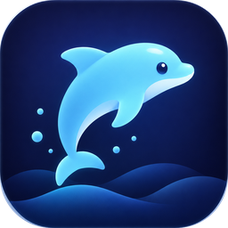

# Soqo Island — A Living Island for Windows

[](https://github.com/rami-hakimi/soqo-island-/actions/workflows/ci.yml)
[](LICENSE)


A customizable floating desktop companion for Windows, with timers, music controls,
notifications, productivity tools and Soqi the Dolphin.

[Features](#key-features) · [Installation](#installation) · [How to use](#how-to-use) · [Docs](docs/) · [Changelog](CHANGELOG.md)

</div>

## About

Soqo Island is a small glass capsule that floats at the top of your screen, inspired by
Dynamic Island-style interfaces. Collapsed, it shows what matters right now: the song that is
playing, a running timer, a finished download, the next meeting. Rest the pointer on it and it
opens into a panel with music controls, apps, files, downloads and system information; move
away and it folds back without taking focus from your work. Soqi, an original dolphin
character, lives beside the island and reacts to what happens on your PC and to a click. The
interface is available in English, Arabic and Dutch.

## Screenshots and promotional artwork

### Concept artwork

These five illustrations show the intended look and ideas. They are **concept artwork, not
screenshots**, and may differ in detail from the application.

| | |
|---|---|
| 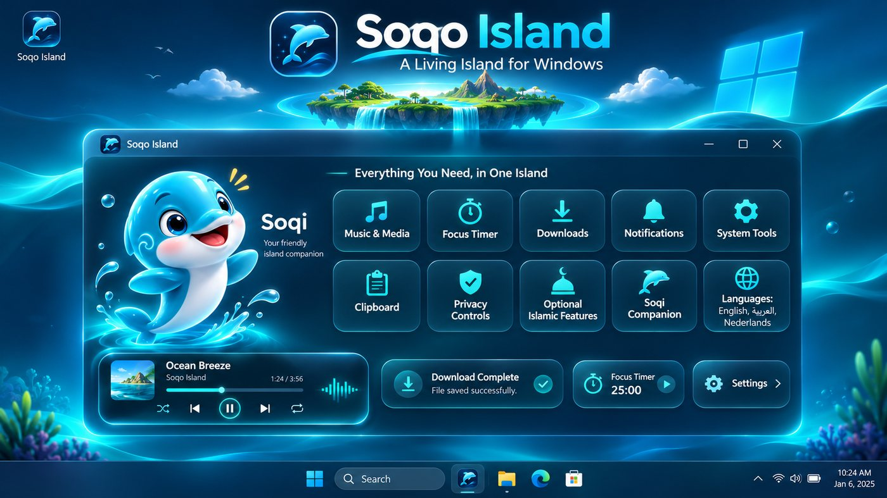 | 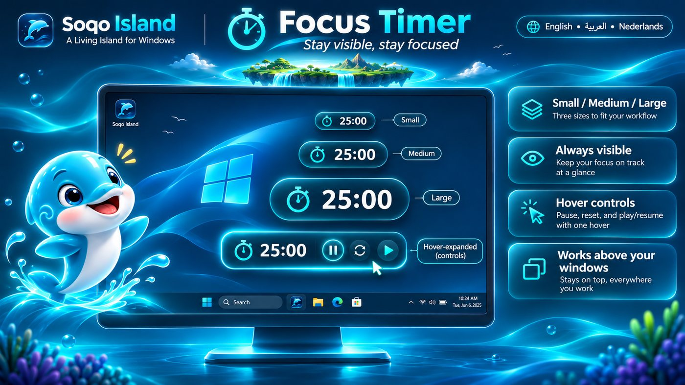 |
| Overview | Focus timer |
| 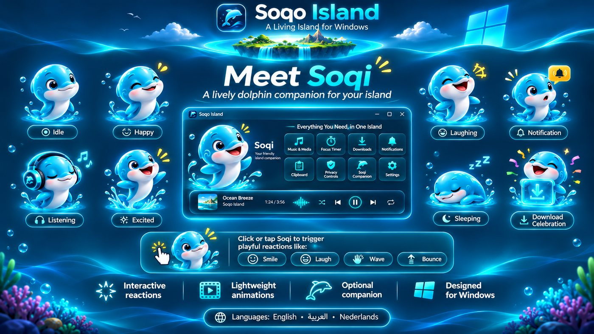 | 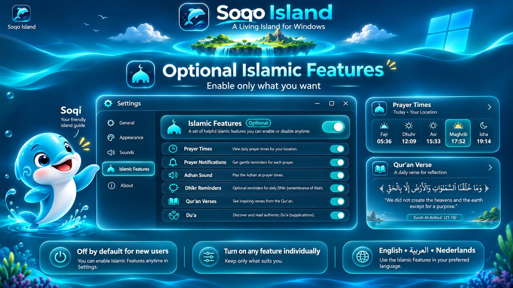 |
| Soqi the Dolphin | Optional Islamic Features |
| 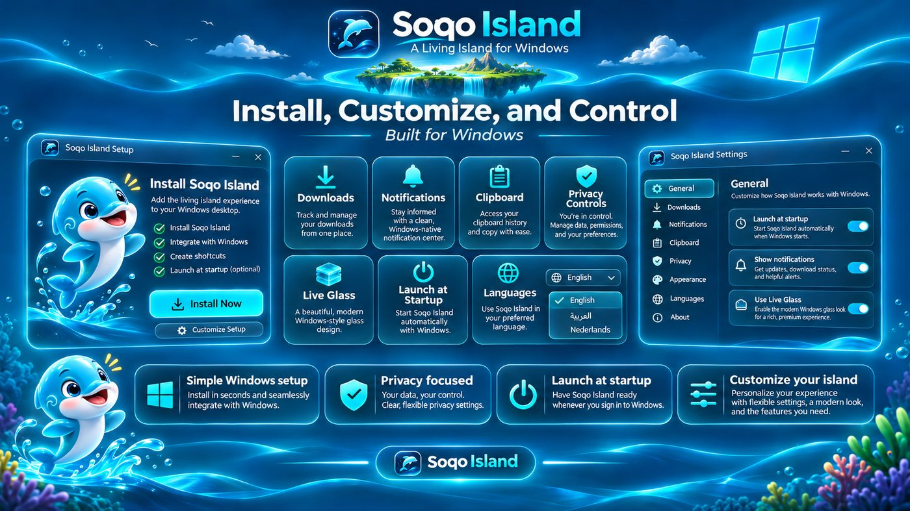 | |
| Windows experience | |

### Application screenshots

Genuine captures of the running application (Windows 11, 125 % scaling).

| | |
|---|---|
| 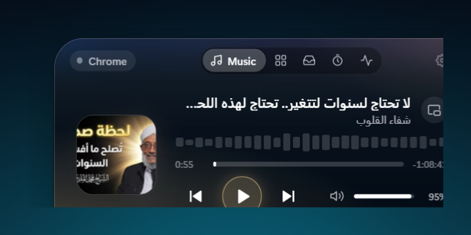 | 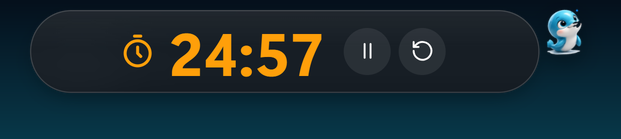 |
| Music view | Large timer pill on hover |
|  | 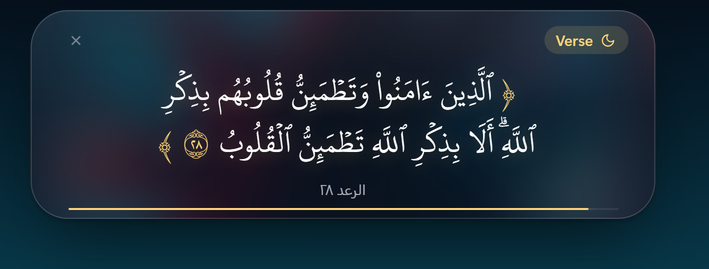 |
| Soqi beside the island | Qur'an verse card (optional Islamic Features) |
| 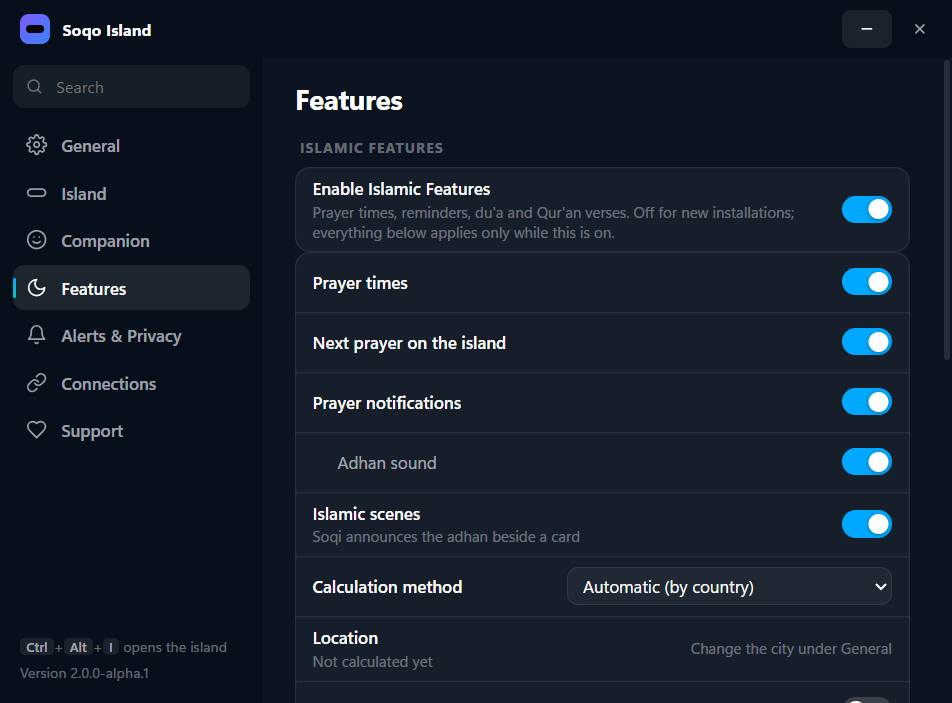 | 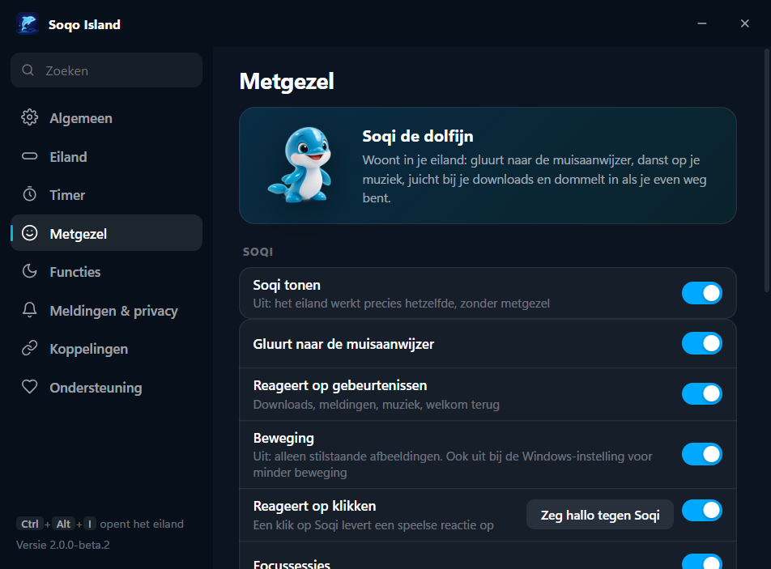 |
| Settings › Features | Settings › Companion, Dutch |
| 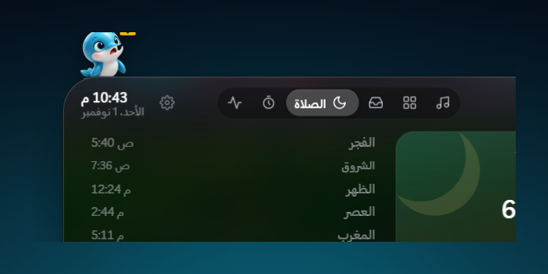 |  |
| Prayer tab, Arabic | Welcome card, Arabic |

More captures are in [`assets/screenshots/app/`](assets/screenshots/app/).

## Key features

| | |
|---|---|
| **Floating desktop island** | Click-through glass capsule that opens on hover, horizontal or vertical, docked or floating, hides in full screen, `Ctrl + Alt + I` to pin |
| **Music and media controls** | Whatever Windows is playing: artwork, title, play/pause/skip, volume and brightness, floating YouTube mini player |
| **Timer and focus tools** | Preset timers and focus/break sessions; a running-timer pill in three sizes that can stay visible over full-screen apps |
| **Download monitoring** | Browser downloads with progress and speed; live control of the IDM download manager when installed |
| **Clipboard tools** | History kept in memory only; smart actions for copied links, colours and sums |
| **Notifications** | Cards inside the island for downloads, screenshots, battery, keyboard language, Caps Lock, network changes and upcoming meetings (iCal) |
| **System shortcuts and utilities** | Pinned app launcher with Start-menu search, a shelf for files, CPU/RAM, weather, screenshots straight to the shelf |
| **Soqi, the animated dolphin** | Ten moods driven by real events, a playful reaction when clicked, gentle idle motion, a bob to the music; switchable off, follows reduced-motion |
| **Privacy controls** | No account, no telemetry; microphone and camera indicators; the live-glass screen capture can be turned off ([details](docs/PRIVACY.md)) |
| **Appearance customization** | Orientation, docking, live or static glass, timer size, Soqi options |
| **Automatic startup** | *Launch at Windows startup* starts the island quietly at sign-in; removed by the uninstaller |
| **English, Arabic and Dutch** | Switchable live, with full right-to-left layouts for Arabic |
| **Optional Islamic Features** | Prayer times calculated on your PC, notifications, dhikr, du'a and Qur'an verses. **Disabled by default** for new installations; one switch under Settings › Features |

## Installation

Windows 10 or 11, 64-bit. No account is needed.

> **No installer has been published yet.** The first public beta (2.0.0-beta.2) will appear on
> the Releases page below; until then you can build from source (see [Built with](#built-with)).

1. Open the [Releases page](https://github.com/rami-hakimi/soqo-island-/releases).
2. Download the latest Windows installer, `Soqo-Island-Setup-<version>.exe`.
3. Run it. The installer is **not code-signed**, so Microsoft SmartScreen may show
   "Windows protected your PC". Only continue (*More info → Run anyway*) for a file you
   downloaded from this repository's Releases page; check that the app name reads Soqo Island.
4. Complete the installation. It installs for the current user without administrator rights
   and offers English, Arabic and Dutch.
5. Launch Soqo Island from the installer's last page or the Start menu. The island appears at
   the top of your screen with a dolphin icon in the notification area.
6. Right-click the island or the tray icon and choose **Settings…** to pick the language and
   your preferences, and turn on *Launch at Windows startup* if you want it at every sign-in.

Installing a newer version over an existing one keeps your settings. Uninstalling from
Windows Settings › Apps removes the program, its shortcuts and the startup entry.

## How to use

- **Open and close**: rest the pointer on the pill to open the island, move away to close it.
  `Ctrl + Alt + I` pins it open. Drag the pill to move the island; drop it near the top edge to
  dock it.
- **Music**: when something plays, the Music view shows artwork and controls; the scroll wheel
  over the pill changes the volume.
- **Timer**: open the Timer tab, pick a duration or start a focus session. Choose the size of
  the running-timer pill under Settings › Timer; Medium and Large show pause and reset on
  hover.
- **Notifications**: cards appear in the island and the × closes them at once. Each kind can
  be switched off under Settings › Alerts & Privacy.
- **Soqi**: click her for a reaction; adjust or hide her under Settings › Companion.
- **Language**: Settings › General › Language (Automatic, English, العربية, Nederlands).
- **Islamic Features**: Settings › Features › Islamic Features; nothing related runs while the
  switch is off.
- **Exit**: right-click the island or the tray icon › Quit. Startup can be turned off under
  Settings › General or in Windows Settings › Apps › Startup.

## Built with

- [Electron](https://www.electronjs.org/) 44 and Node.js 22
- JavaScript (CommonJS main process, classic-script renderers) checked with TypeScript
  `checkJs`; HTML and CSS; no bundler
- A small C# helper (`helper/`) for Windows media sessions, audio, brightness, UI Automation
  and the Start-menu catalogue
- electron-builder (NSIS installer), electron-updater, node-ical
- Weather and city search data by [Open-Meteo.com](https://open-meteo.com/) (CC BY 4.0)
- ESLint and `node:test`; GitHub Actions for CI and a tag-gated release workflow

```bash
git clone https://github.com/rami-hakimi/soqo-island-.git
cd soqo-island-
npm install
npm start          # run from source
npm run verify     # syntax, lint, types, translations, tests
npm run dist       # build the installer into dist/
```

Architecture, localisation, privacy, security, releasing and release notes are in
[`docs/`](docs/). Contributions are welcome: see [CONTRIBUTING.md](CONTRIBUTING.md).

## Developer

**Developed by Rami al-Hakimi** · [github.com/rami-hakimi](https://github.com/rami-hakimi)

## License

Soqo Island is free software under the [GNU General Public License v3.0](LICENSE).
It is based on the GPL-licensed Nova Island project; upstream authorship, the modification
notice and all third-party credits (including the KFGQPC Hafs Qur'an font, which is not
covered by the GPL) are in [NOTICE.md](NOTICE.md); the licence texts of bundled components
are in [THIRD_PARTY_NOTICES.md](THIRD_PARTY_NOTICES.md).
